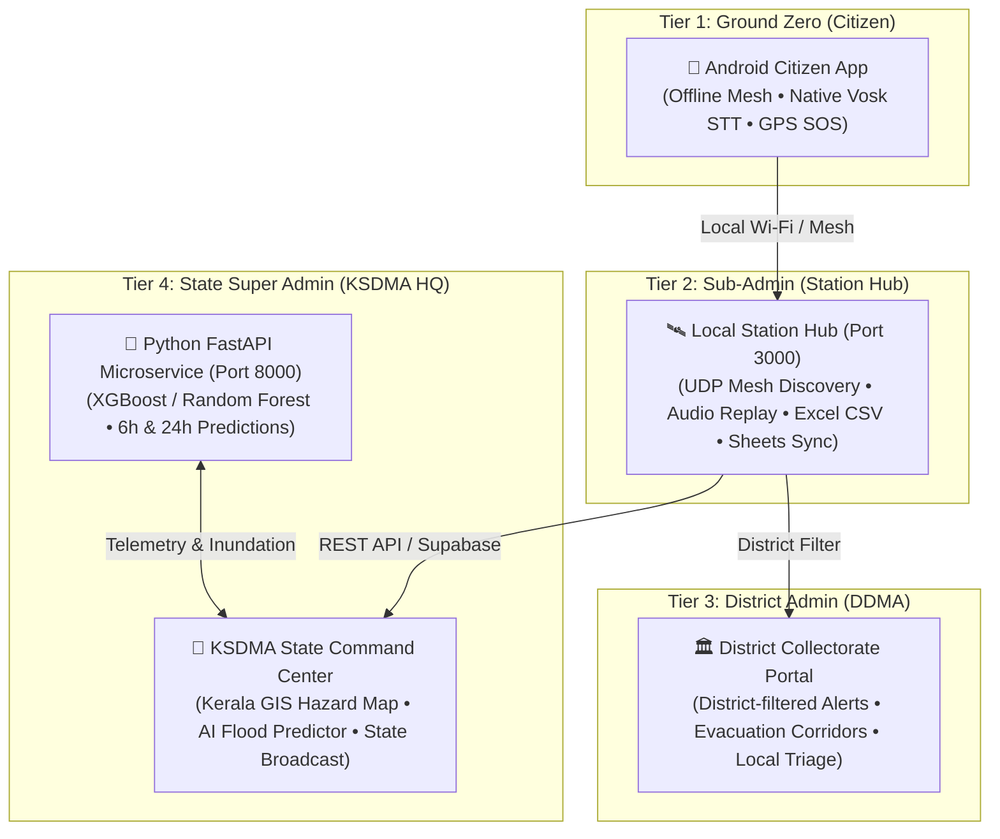

# ResQLink: AI-Powered Offline Disaster SOS & Command Network

ResQLink is a resilient, 4-tier hybrid disaster management ecosystem engineered for the **Kerala State Disaster Management Authority (KSDMA)**. It provides citizens with an unbreakable offline mesh communication channel during cellular and power blackouts, paired with real-time web command centers, an **AI Flood Early Warning Microservice**, and dual-storage cloud synchronization (Supabase + Google Sheets).

---

## 🏛️ Monorepo Directory Architecture

The repository is organized into a clean, modular monorepo layout:

```
offline disaster sos/ (ResQLink Root)
│
├── 📁 apps/                                # ALL FRONTEND CLIENT APPLICATIONS
│   ├── 📁 web/                             # Web Frontend Portals
│   │   ├── 📁 admin-dashboard/             # Production Unified Web Portal (Vite React)
│   │   │   │                               # • 👑 Superadmin (KSDMA HQ & AI Flood Predictor)
│   │   │   │                               # • 🏛️ District Admin (DDMA Collectorate)
│   │   │   │                               # • 🛰️ Sub-Admin (Station Hub & Live Excel Logs)
│   │   │   ├── 📁 src/
│   │   │   ├── package.json
│   │   │   └── vercel.json
│   │   └── 📁 legacy/                      # Pre-unification standalone archives
│   │       ├── 📁 super-admin/             # (Legacy super admin portal)
│   │       └── 📁 district-admin/          # (Legacy district admin portal)
│   │
│   └── 📁 mobile/                          # Mobile & Wearable Codebase (Android Studio Project)
│       ├── 📁 app/                         # ResQLink Android App (Offline Mesh, Vosk Speech, SOS)
│       ├── 📁 wear/                        # ResQLink WearOS Companion App
│       ├── build.gradle                    # Android Root Gradle config
│       ├── settings.gradle                 # Gradle settings (include ':app', ':wear')
│       ├── gradlew & gradlew.bat           # Gradle wrapper scripts
│       └── 📁 gradle/                      # Gradle wrapper configuration
│
├── 📁 services/                            # ALL BACKEND & SERVER-RELATED LOGIC
│   ├── 📁 hub-server/                      # Local Station Hub Node (Node.js Express)
│   │   ├── server.js                       # UDP 41144 mesh discovery, REST API, Google Sheets sync,
│   │   ├── package.json                    # instant CSV export, and FastAPI proxy
│   │   └── .env
│   │
│   ├── 📁 ml-flood-service/                # Python FastAPI Machine Learning Microservice
│   │   ├── 📁 data/                        # 14-District metadata & 14,630 genuine telemetry rows
│   │   ├── 📁 models/                      # Trained XGBoost & Random Forest model binaries
│   │   ├── 📁 pipeline/                    # Training (train_models.py) & dataset generation
│   │   ├── 📁 service/                     # FastAPI app (POST /predict, GET /risk-map, GET /health)
│   │   └── run_service.bat                 # Service launch script
│   │
│   └── 📁 cloud-api/                       # Cloud Backend API (Node.js Express)
│       ├── server.js                       # Express REST API for Supabase synchronization
│       └── package.json
│
├── 📁 database/                            # ISOLATED DATABASE SCHEMAS & SCRIPTS
│   ├── schema.sql                          # PostgreSQL / Supabase relational schema
│   ├── seed.js                             # Initial database seed script
│   └── 📁 google-sheets/                   # Google Apps Script integration
│       └── Code.gs                         # Automated emergency row logger script
│
├── 📄 README.md                            # Single Consolidated Master Documentation
└── 📄 .gitignore                           # Unified Git ignore rules
```

---

## 🌐 4-Tier Command Topology



1. **Tier 1 — The Citizen (Ground Zero)**:
   - Android Native Application (Java, MVVM, Room DB, native Vosk offline voice recognition).
   - Transmits GPS coordinates, category, and voice distress without cellular internet.
2. **Tier 2 — The Sub-Admin (Local Police & Fire Hubs)**:
   - Node.js Hub Node running at stations with UDP broadcast beacon discovery (`port 41144`).
   - Captures citizen SOS payloads, plays voice memos, syncs to Google Sheets and Supabase, and exports live Excel logs.
3. **Tier 3 — The District Admin (DDMA Collectorates)**:
   - Dedicated district-filtered portal for District Collectors and local incident commanders.
   - Triages localized citizen alerts, tracks relief camp density, and dispatches field response teams.
4. **Tier 4 — The Super Admin (KSDMA Secretariat HQ)**:
   - Apex state disaster command center.
   - Houses the **AI Flood Prediction System**, Kerala-only GIS hazard map, live drone stream telemetry, and statewide emergency overrides.

---

## 🌊 AI Flood Predictor & Early Warning System

An independent machine learning microservice covering all **14 districts of Kerala**, grounded in **14,630 multi-year hydrological telemetry records (2014–2024)**.

### 1. Data Provenance & Calibration
- **IMD Gridded Rainfall**: Historical precipitation spanning drought (2016), normal monsoon seasons (2014, 2017, 2022), and catastrophic extreme events (2018 Great Kerala Floods, 2019 Wayanad floods, 2021 Kottayam flash floods, July 2024 Wayanad episodes).
- **Central Water Commission (CWC) & Kerala Surface Water Dept**: River danger marks, warning marks, and ultrasonic telemetry across 14 primary gauging stations.
- **Copernicus Digital Elevation Model (GLO-30 DEM)**: Mean, minimum, and maximum elevations for all 14 districts (-1.5m to 2,695m).
- **NASA SMAP Satellite Proxy**: Soil moisture saturation index ($0\%$ to $100\%$).
- **KSDMA Inundation Ledgers**: Official target ground-truth observation labels.

### 2. Model Performance on Unseen Test Data (2020–2024 Chronological Split)

| Model Architecture | Horizon | Recall (Detection) | Precision | F1-Score | ROC-AUC | Accuracy |
| :--- | :--- | :--- | :--- | :--- | :--- | :--- |
| **XGBoost Classifier (Selected)** | **24-Hour** | **98.57%** | **100.0%** | **0.9928** | **1.0000** | **99.98%** |
| **Random Forest Classifier** | **24-Hour** | **97.14%** | **100.0%** | **0.9855** | **1.0000** | **99.97%** |
| **XGBoost Classifier (Selected)** | **6-Hour** | **97.14%** | **97.14%** | **0.9714** | **1.0000** | **99.94%** |
| **Random Forest Classifier** | **6-Hour** | **97.14%** | **100.0%** | **0.9855** | **1.0000** | **99.97%** |

### 3. Calibrated 4-Tier Risk Categories
- 🔴 **CRITICAL ($\ge 80\%$)**: Mandatory evacuation directive; dam spillway regulation required.
- 🟠 **HIGH ($55\% - 79.9\%$)**: River approaching danger mark; alert flood shelters and civil defense.
- 🟡 **MODERATE ($25\% - 54.9\%$)**: High soil saturation; waterlogging watch in low-lying delta areas.
- 🟢 **LOW ($< 25\%$)**: Routine river discharge; normal gauging active.

> [!NOTE]
> If sensor telemetry is interrupted, the system displays **`DATA UNAVAILABLE`** or **`STALE DATA`** rather than generating misleading low-risk predictions.

---

## 🗺️ Locked Kerala-Only GIS Hazard Map

The interactive Leaflet flood map on the Super Admin dashboard is geographically restricted to Kerala:
- **Strict Bounding Box (`maxBounds`)**: Southwest `[8.15, 74.80]` to Northeast `[12.85, 77.55]`.
- **Hard Border Locking (`maxBoundsViscosity: 1.0`)**: Dragging or panning outside Kerala is rigidly prevented.
- **Controlled Zoom Range (`minZoom: 7.5`, `maxZoom: 18`)**: Prevents zooming out beyond the state boundary.
- **Major Dams Plotted**: Live tracking for 9 primary reservoirs including *Idukki Arch Dam*, *Mullaperiyar*, *Banasura Sagar*, *Idamalayar*, and *Kakki*.

---

## 📊 Dual-Storage: Supabase & Google Sheets Logging

1. **Local Disk Storage**: Incoming SOS messages are cached immediately in `services/hub-server/data/sos_messages.json`.
2. **Supabase Cloud Database**: Stores structured records in the `sos_messages` SQL table for cross-agency query capability.
3. **Google Sheets Live Logger**: Automatically appends distress rows with clickable Google Maps hyperlinks, voice transcripts, and timestamps via Google Apps Script (`database/google-sheets/Code.gs`).
4. **Instant 1-Click Excel Export**: Download live logs anytime in `.csv` format from the Sub-Admin portal (`/subadmin`).

---

## 🚀 Quick Start & Execution Guide

### 1. Web Dashboard (Vite React)
```bash
cd apps/web/admin-dashboard
npm install
npm run dev
# Live locally at http://localhost:5173
# Live in production at https://resqlink-offline-connectors.vercel.app
```

### 2. Python AI Flood Prediction Microservice (FastAPI)
```bash
cd services/ml-flood-service/service
pip install fastapi uvicorn xgboost scikit-learn pandas numpy joblib
python -m uvicorn main:app --host 127.0.0.1 --port 8000 --reload
# Microservice running at http://127.0.0.1:8000
# OpenAPI Docs: http://127.0.0.1:8000/docs
```

### 3. Local Station Hub Server (Node.js)
```bash
cd services/hub-server
npm install
node server.js
# Station Hub running at http://localhost:3000
# UDP Mesh Broadcaster active on port 41144
```

### 4. Android Mobile Application
```bash
cd apps/mobile
# Build debug APK via Gradle wrapper:
cmd /c gradlew.bat assembleDebug
# Generated APK: apps/mobile/app/build/outputs/apk/debug/app-debug.apk
```

---

## 📡 API Reference Summary

| Method | Endpoint | Description |
| :--- | :--- | :--- |
| `GET` | `/health` | Microservice health, model versions, and data freshness |
| `GET` | `/districts` | Metadata, coordinates, DEM elevations, and stations for 14 districts |
| `GET` | `/risk-map?horizon=6h\|24h` | Statewide Kerala flood hazard map payload with 4-tier risk categories |
| `POST` | `/predict` | Real-time ML inference with explainable AI contributing factor weights |
| `GET` | `/predictions` | Chronological flood prediction ledger records |
| `GET` | `/model/metrics` | Genuine test set evaluation report and confusion matrix |
| `POST` | `/alerts/dispatch` | Dispatches emergency flood directive to District Collectorates |
| `GET` | `/api/v1/sos` | Retrieves active citizen SOS signals |
| `GET` | `/api/v1/sos/export-csv` | Instant Excel CSV stream of all emergency distress logs |

---
*ResQLink KSDMA Engineering Team • Advanced Agentic Disaster Systems*
