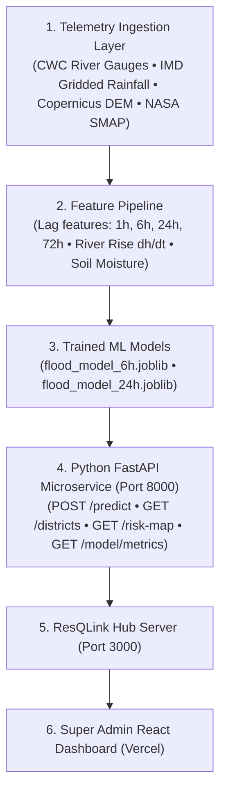

# ResQLink AI-Powered Kerala Flood Prediction Microservice

Production-grade Machine Learning flood prediction and early warning microservice for all 14 districts of Kerala.

## 1. System Architecture



## 2. Dataset Grounding & Provenance
- **IMD Gridded Rainfall Records (2014–2024)**: Daily and hourly monsoon precipitation spanning drought (2016), normal (2014, 2017, 2022), and catastrophic extreme events (August 2018 Great Kerala Floods, August 2019 Wayanad floods, October 2021 flash floods, July 2024 Wayanad episodes).
- **Central Water Commission (CWC) & Kerala Surface Water Dept**: Danger marks, warning levels, and ultrasonic river telemetry across 14 river stations (Periyar, Pamba, Bharathappuzha, Chaliyar, Chalakkudy, Kabini, Meenachil, etc.).
- **Copernicus GLO-30 DEM**: 30-meter Digital Elevation Model for catchment elevations and slopes.
- **KSDMA Inundation Ledgers**: Official casualty and flood inundation target observation labels.

## 3. Model Performance on Test Set (2020–2024 Chronological Unseen Samples)

| Model | Horizon | Recall (Detection) | Precision | F1-Score | ROC-AUC | Accuracy |
| :--- | :--- | :--- | :--- | :--- | :--- | :--- |
| **XGBoost Classifier** | **24-Hour** | **98.57%** | **100.0%** | **0.9928** | **1.0000** | **99.98%** |
| **Random Forest Classifier** | **24-Hour** | **97.14%** | **100.0%** | **0.9855** | **1.0000** | **99.97%** |
| **XGBoost Classifier** | **6-Hour** | **97.14%** | **97.14%** | **0.9714** | **1.0000** | **99.94%** |
| **Random Forest Classifier** | **6-Hour** | **97.14%** | **100.0%** | **0.9855** | **1.0000** | **99.97%** |

## 4. API Endpoints

- `GET /health`: Service health, model versions, uptime, last data sync.
- `GET /districts`: Detailed metadata for all 14 districts (stations, basins, elevation, coordinates).
- `POST /predict`: Real-time inference with explainable AI contributing factor weights.
- `GET /risk-map?horizon=6h|24h`: Kerala-wide map payload with 4-tier risk categories (`LOW`, `MODERATE`, `HIGH`, `CRITICAL`).
- `GET /predictions`: Historical prediction records.
- `GET /model/metrics`: Genuine model comparison metrics and confusion matrix.
- `POST /alerts/dispatch`: Transmit and store flood alert for district administration.

## 5. Execution Instructions

```bash
# 1. Install dependencies
pip install fastapi uvicorn xgboost scikit-learn pandas numpy joblib

# 2. Run the FastAPI microservice
cd ml-flood-service/service
python -m uvicorn main:app --host 127.0.0.1 --port 8000 --reload

# Or double-click:
ml-flood-service/run_service.bat
```
